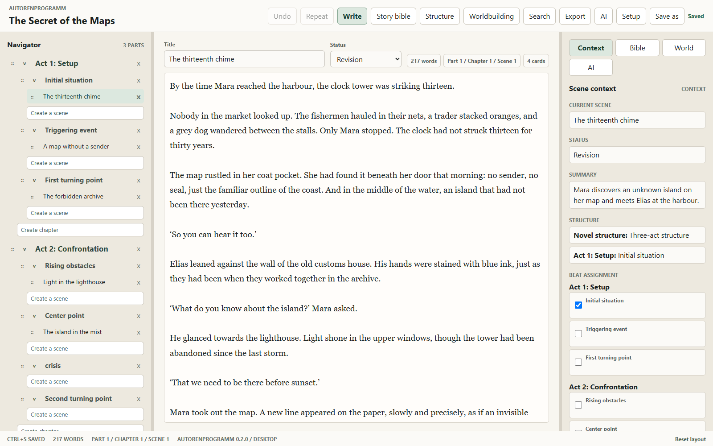
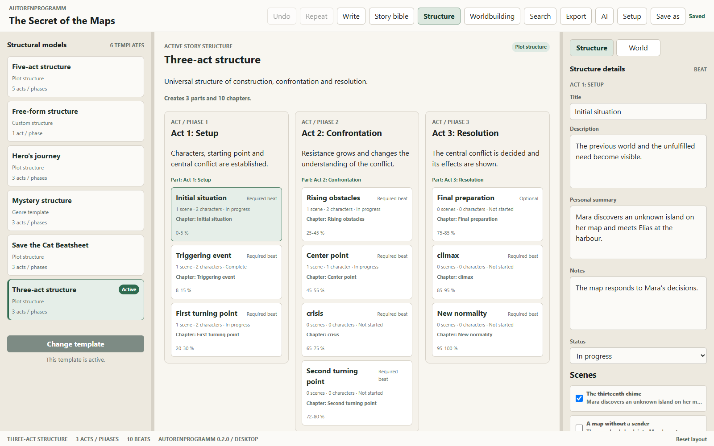
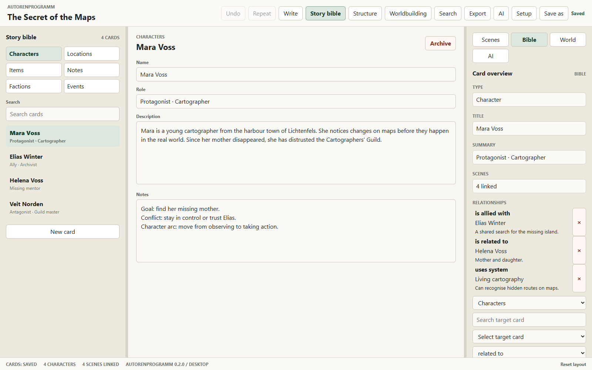
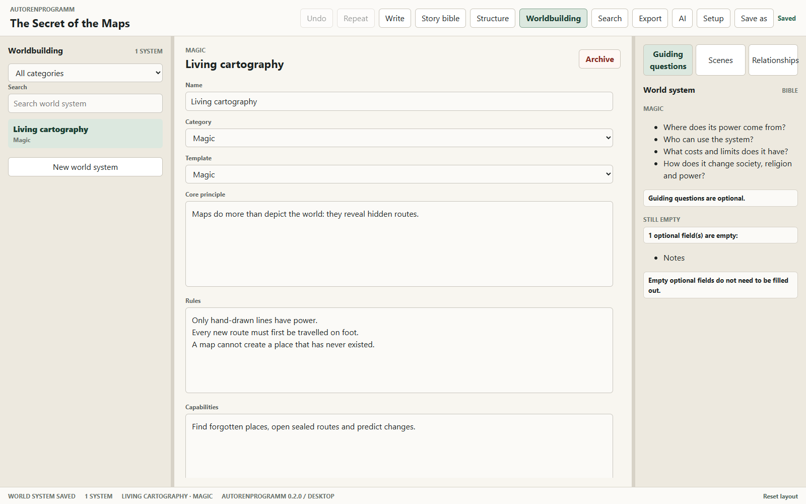

# Autorenprogramm

[Deutsch](README.md) | [English](README.en.md)

Autorenprogramm is a local Windows desktop application for complex novel projects. Test version 0.2.0 combines manuscript writing, story structure, a project bible, worldbuilding, search, export and optional local writing assistance through Ollama.

> **Early test build:** Version 0.2.0 is an unsigned pre-release for voluntary testing. Use copies or disposable projects and back up important project files regularly.

## A look inside the application

These screenshots show the version 0.2.0 interface with the fictional example project “The Secret of the Maps”.

### Write the manuscript

Browse parts, chapters and scenes in the navigator on the left, write in the centre and keep scene context and story beats alongside the text.



### Plan the story

Structure templates organise the plot into acts and beats. Your own summaries, progress statuses and linked scenes connect the plan to the manuscript.



### Organise characters and relationships

The project bible collects characters, locations, items, notes, factions and events. Cards can link to scenes, other cards and world systems.



### Develop the world

World systems describe subjects such as magic or technology through principles, rules, capabilities and limits. Templates and guiding questions support their development.



## Included features

- Local `.autorenprojekt` files with an immutable project language: German or British English
- Parts, chapters and scenes with autosave, status, undo/redo and flexible ordering
- Story structures with acts, beats, scene links and character links
- A project bible for characters, locations, items, notes, factions and events
- Relationships between project-bible cards and linkable world systems
- Project-wide search, project copies and Markdown or DOCX export
- Optional local AI for writing chat, text improvement, scene analysis and project-bible suggestions

The project language controls the interface, built-in templates, default names, generated filenames and the AI's default response language. Existing user-written text is never translated automatically.

## System requirements

- Windows 10 or Windows 11, x64
- Microsoft Edge WebView2 Runtime, normally already installed by Windows
- For AI features: [Ollama](https://ollama.com/) and at least one locally installed text model

Ollama and its models are not included in the installer. Every feature except AI remains available without Ollama.

## Installation

1. Download `Autorenprogramm_0.2.0_x64-setup.exe` and `Autorenprogramm_0.2.0_x64-setup.exe.sha256` from the `v0.2.0` GitHub pre-release.
2. Optionally compare the SHA-256 checksum in PowerShell:

   ```powershell
   Get-FileHash .\Autorenprogramm_0.2.0_x64-setup.exe -Algorithm SHA256
   ```

3. Start the installer. The test build is not digitally signed yet, so Windows SmartScreen may show a warning. Continue only when the filename, release source and checksum match.
4. Read the evaluation licence and complete the current-user installation.

## First test

1. Create a German or English project in a folder of your choice.
2. Create and link scenes, story beats, project-bible cards and a world system.
3. Save a project copy and export the manuscript as both Markdown and DOCX.
4. Close and reopen the project; its text and project language must remain unchanged.
5. For local AI, start Ollama, install at least one model and select it in the application settings.

The full test checklist is available in [TESTING.en.md](TESTING.en.md). Report defects and feedback through [GitHub Issues](https://github.com/OnekoSL/Autorenprogramm/issues).

## Data and privacy

Project files remain in the location chosen by the user. The application has no telemetry and no cloud service of its own. AI requests are sent exclusively to the local Ollama service at `http://localhost:11434`. The authoritative privacy information is in [PRIVACY.md](PRIVACY.md).

## Uninstallation and updates

The application can be removed through Windows Settings. User-created project files and exports are not deleted. Version 0.2.0 has no automatic updater; later test versions are distributed as separate GitHub pre-releases.

## Development

Node.js, Rust and the [Tauri prerequisites for Windows](https://v2.tauri.app/start/prerequisites/) are required.

```powershell
npm.cmd ci
npm.cmd run tauri dev
```

Automated checks:

```powershell
npm.cmd run check:version
npm.cmd run check:i18n
npm.cmd run test:coverage
npm.cmd run build
cargo fmt --check --manifest-path src-tauri/Cargo.toml
cargo clippy --locked --manifest-path src-tauri/Cargo.toml --all-targets -- -D warnings
cargo test --locked --manifest-path src-tauri/Cargo.toml
```

Local installer build:

```powershell
npx.cmd tauri build --bundles nsis
```

## Licence

The source is visible but is not open source. It may only be used under the [Autorenprogramm evaluation licence](LICENSE.md). Copyright © 2026 OnekoSL.
