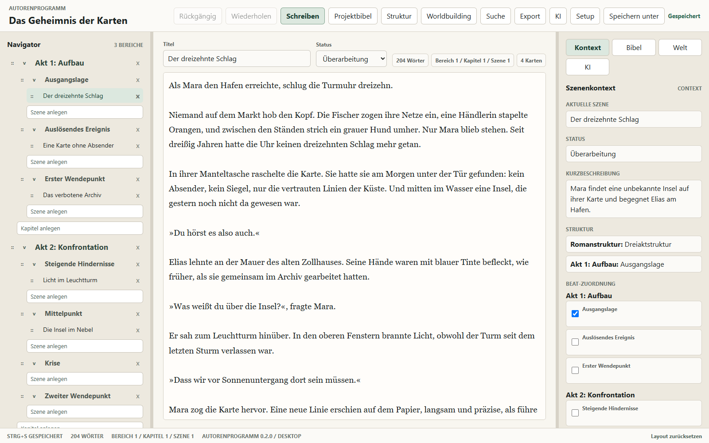
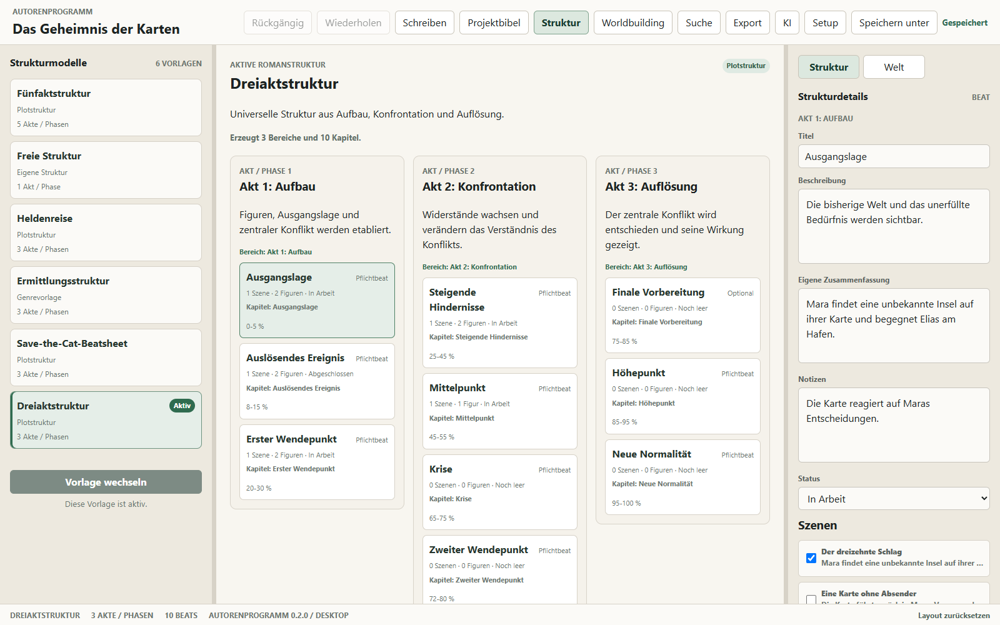
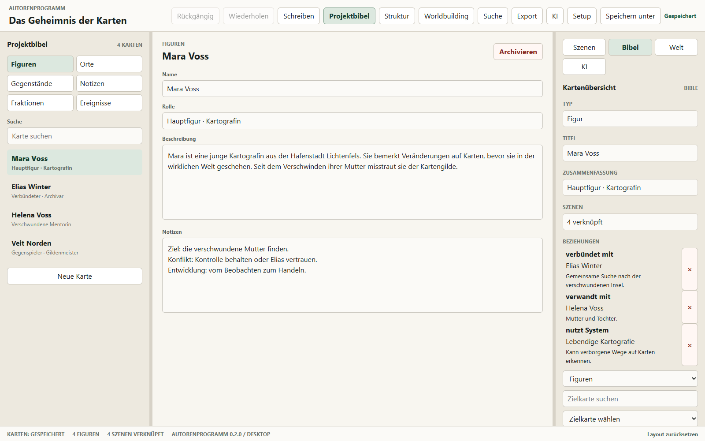
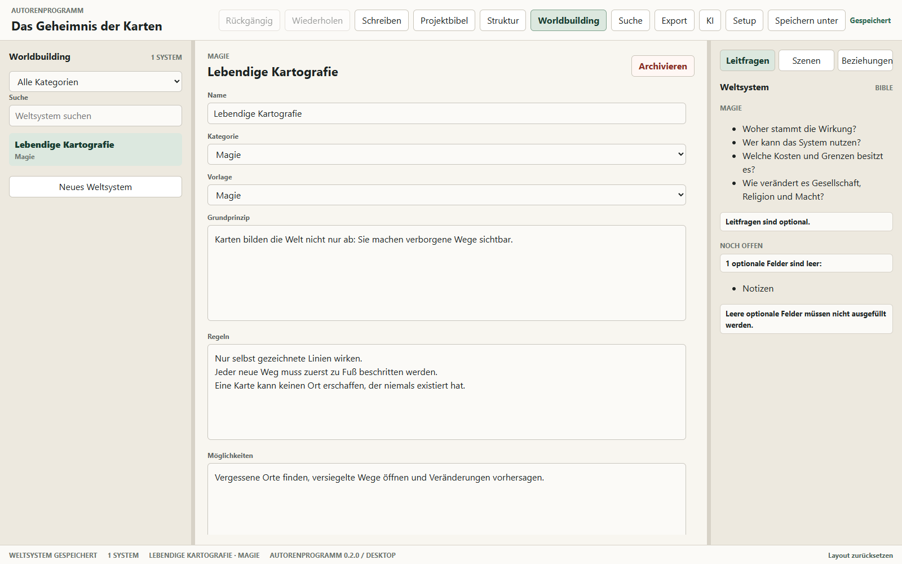

# Autorenprogramm

[Deutsch](README.md) | [English](README.en.md)

Autorenprogramm ist eine lokale Windows-Desktop-App für komplexe Romanprojekte. Die Testversion 0.2.0 verbindet Manuskript, Story-Struktur, Projektbibel, Worldbuilding, Suche, Export und eine optionale lokale Schreibassistenz über Ollama.

> **Frühe Testversion:** Version 0.2.0 ist ein unsigniertes Pre-release für freiwillige Tests. Verwende Kopien oder Testprojekte und sichere wichtige Projektdateien regelmäßig.

## Einblicke in das Programm

Die Screenshots zeigen die Oberfläche von Version 0.2.0 mit dem fiktiven Beispielprojekt „Das Geheimnis der Karten“.

### Manuskript schreiben

Bereiche, Kapitel und Szenen links im Navigator, der Text in der Mitte und Szenenkontext sowie Story-Beats rechts.



### Handlung planen

Strukturvorlagen gliedern die Handlung in Akte und Beats. Eigene Zusammenfassungen, Status und verknüpfte Szenen halten die Planung mit dem Manuskript zusammen.



### Figuren und Beziehungen organisieren

Die Projektbibel sammelt Figuren, Orte, Gegenstände, Notizen, Fraktionen und Ereignisse. Karten lassen sich mit Szenen, anderen Karten und Weltsystemen verknüpfen.



### Die Welt ausarbeiten

Weltsysteme beschreiben etwa Magie oder Technologie mit Grundprinzipien, Regeln, Möglichkeiten und Grenzen. Vorlagen und Leitfragen unterstützen die Ausarbeitung.



## Enthaltene Funktionen

- Lokale `.autorenprojekt`-Dateien mit unveränderlicher Projektsprache Deutsch oder britisches Englisch
- Bereiche, Kapitel und Szenen mit Autosave, Status, Undo/Redo und frei wählbarer Reihenfolge
- Story-Strukturen mit Akten, Beats sowie Szenen- und Figurenverknüpfungen
- Projektbibel für Figuren, Orte, Gegenstände, Notizen, Fraktionen und Ereignisse
- Beziehungen zwischen Projektbibel-Karten sowie verknüpfbare Weltsysteme
- Projektweite Suche, Projektkopien und Export nach Markdown oder DOCX
- Optionale lokale KI für Schreibchat, Textverbesserung, Szenenanalyse und Projektbibel-Vorschläge

Die Projektsprache steuert Oberfläche, eingebaute Vorlagen, Standardnamen, Dateinamen und die Standardsprache der KI. Bereits gespeicherte Nutzertexte werden niemals automatisch übersetzt.

## Systemvoraussetzungen

- Windows 10 oder Windows 11, x64
- Microsoft Edge WebView2 Runtime; Windows installiert sie normalerweise bereits
- Für KI-Funktionen: [Ollama](https://ollama.com/) und mindestens ein lokal installiertes Textmodell

Ollama und Modelle sind nicht Bestandteil des Installers. Alle Funktionen außer der KI können ohne Ollama verwendet werden.

## Installation

1. Im GitHub Pre-release `v0.2.0` die Dateien `Autorenprogramm_0.2.0_x64-setup.exe` und `Autorenprogramm_0.2.0_x64-setup.exe.sha256` herunterladen.
2. Optional die SHA-256-Prüfsumme in PowerShell vergleichen:

   ```powershell
   Get-FileHash .\Autorenprogramm_0.2.0_x64-setup.exe -Algorithm SHA256
   ```

3. Installer starten. Die Testversion ist noch nicht digital signiert; Windows SmartScreen kann deshalb warnen. Nur fortfahren, wenn Dateiname, Release-Quelle und Prüfsumme stimmen.
4. Die Evaluierungslizenz lesen und die Installation für den aktuellen Benutzer abschließen.

## Erster Test

1. Ein deutsches oder englisches Projekt in einem selbst gewählten Ordner anlegen.
2. Szenen, Story-Beats, Projektbibel-Karten und ein Weltsystem erstellen und miteinander verknüpfen.
3. Eine Projektkopie speichern und das Manuskript testweise als Markdown und DOCX exportieren.
4. Das Projekt schließen und erneut öffnen; Texte und Projektsprache müssen unverändert bleiben.
5. Für lokale KI Ollama starten, mindestens ein Modell installieren und dieses in den Einstellungen auswählen.

Die vollständige Testliste steht in [TESTING.md](TESTING.md). Fehler und Feedback können über die [GitHub Issues](https://github.com/OnekoSL/Autorenprogramm/issues) gemeldet werden.

## Daten und Datenschutz

Projektdateien bleiben am gewählten Speicherort. Die App hat keine Telemetrie und keinen eigenen Cloud-Dienst. KI-Anfragen gehen ausschließlich an das lokale Ollama unter `http://localhost:11434`. Details stehen in [PRIVACY.md](PRIVACY.md).

## Deinstallation und Updates

Die App kann über die Windows-Einstellungen deinstalliert werden. Selbst angelegte Projektdateien und Exporte werden dabei nicht gelöscht. Version 0.2.0 besitzt keinen automatischen Updater; neue Testversionen werden als separate GitHub Pre-releases bereitgestellt.

## Entwicklung

Vorausgesetzt werden Node.js, Rust und die [Tauri-Voraussetzungen für Windows](https://v2.tauri.app/start/prerequisites/).

```powershell
npm.cmd ci
npm.cmd run tauri dev
```

Automatische Prüfungen:

```powershell
npm.cmd run check:version
npm.cmd run check:i18n
npm.cmd run test:coverage
npm.cmd run build
cargo fmt --check --manifest-path src-tauri/Cargo.toml
cargo clippy --locked --manifest-path src-tauri/Cargo.toml --all-targets -- -D warnings
cargo test --locked --manifest-path src-tauri/Cargo.toml
```

Lokaler Installer-Build:

```powershell
npx.cmd tauri build --bundles nsis
```

## Lizenz

Der Quellcode ist sichtbar, aber nicht Open Source. Er darf ausschließlich gemäß der [Autorenprogramm-Evaluierungslizenz](LICENSE.md) genutzt werden. Copyright © 2026 OnekoSL.
